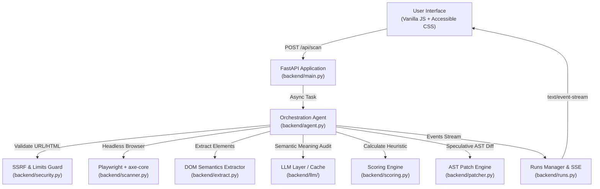

# A11y Pilot Architecture & System Design

## 1. High-Level Architecture



---

## 2. Sequence of the Closed-Loop Agent Remediation Pipeline

```mermaid
sequenceDiagram
    autonumber
    actor User as User / Reviewer
    participant UI as Frontend App
    participant API as FastAPI Backend
    participant Agent as Agent Orchestrator
    participant Scanner as Playwright / axe-core
    participant LLM as LLM Provider
    participant Patcher as AST Patch Engine

    User->>UI: Enter URL or Pasted HTML
    UI->>API: POST /api/scan
    API-->>UI: 202 Accepted {run_id}
    UI->>API: GET /api/runs/{id}/events (SSE)

    rect rgb(238, 244, 246)
        Note over Agent,Scanner: Phase 1: Baseline Scan
        Agent->>Scanner: Load page & run axe-core
        Scanner-->>Agent: baseline_html, axe_issues, aria_snapshot
        Agent->>Agent: Compute baseline score
    end

    rect rgb(254, 243, 199)
        Note over Agent,LLM: Phase 2: AI Semantic Audit
        Agent->>Extractor: Extract compact image/link/field/heading data
        Extractor-->>Agent: compact_json
        Agent->>LLM: Semantic Audit (<page_data>compact_json</page_data>)
        LLM-->>Agent: semantic_issues (alt quality, vague links, heading skips)
        Agent->>Agent: Filter & de-duplicate against baseline DOM
    end

    rect rgb(224, 242, 254)
        Note over Agent,Patcher: Phase 3: Propose Fixes
        loop For Top Fixable Issues
            Agent->>LLM: Explain & Fix Prompt
            LLM-->>Agent: explanation, wcag, patch, confidence
            Agent->>Patcher: dry_run(baseline_html, patch)
            Patcher-->>Agent: before_snippet, after_snippet, unified_diff
        end
        Agent->>UI: Emit fix_proposed & status awaiting_review
    end

    User->>UI: Inspect diffs & Approve Fixes
    UI->>API: POST /api/runs/{id}/apply {approved_fix_ids}

    rect rgb(220, 252, 231)
        Note over Agent,Scanner: Phase 4: Apply & Verify Loop
        loop For Each Approved Fix
            Agent->>Patcher: apply_patch(state_html, patch)
            Patcher-->>Agent: candidate_html
            Agent->>Scanner: rescan_html(candidate_html)
            Scanner-->>Agent: re_issues, re_score, re_aria
            alt Issue Resolved & No Regression
                Agent->>Agent: state_html = candidate_html; mark applied
            else Regression or Unresolved (Attempt < Max)
                Agent->>LLM: Adapt patch with feedback (Retry)
            else Max Retries Exceeded
                Agent->>Agent: Roll back to previous state_html; mark reverted
            end
        end
    end

    Agent->>Scanner: Final verification scan
    Agent->>UI: Emit run_completed & report ready
    UI->>User: Display Before vs After Report, ARIA diff, Download fixed.html
```

---

## 3. AST Patch Whitelist Specification

The patch engine in `backend/patcher.py` enforces an AST-level whitelist. Any mutation not conforming to these rules is immediately rejected.

| Operation | Allowed Targets | Permitted Arguments / Attributes | Security Validations |
|---|---|---|---|
| `set_attr` | Any non-forbidden tag | `alt`, `aria-label`, `aria-labelledby`, `aria-describedby`, `aria-hidden`, `lang`, `role`, `title`, `for`, `id`, `tabindex` | Tabindex must be `"0"` or `"-1"`; role must be in valid ARIA role set; `aria-hidden` only `"true"`/`"false"`; `lang` must match BCP 47; plain text max 160 chars; no `<` or `>` brackets. |
| `remove_attr` | Any non-forbidden tag | `aria-hidden`, `tabindex`, `role`, `title`, `aria-label`, `aria-labelledby`, `aria-describedby` | Never removes functional attributes (`href`, `src`, `id`, handlers). |
| `set_text` | `a`, `button`, `label`, `h1`-`h6`, `span`, `summary`, `legend` | `value` (plain string) | Plain text max 120 chars; stripped HTML; non-empty. Element must not contain child elements (e.g. `<svg>`). |
| `wrap_label` | `input` (non-hidden), `select`, `textarea` | `label_text` (plain string) | Target cannot be hidden/submit/button. Creates unique `id="a11y-field-N"` if absent. Inserts `<label for="id">` before control. Max 80 chars. |
| `add_css` | Any non-forbidden tag | `property`, `value` | Properties restricted to `color`, `background-color`, `font-size`, `outline`, `outline-offset`, `text-decoration`, `min-width`, `min-height`. Strict regex: hex/rgb colors, dimensions. No `url()`, `expression`, `;`, `@import`. |
| `change_tag` | `h1` through `h6` | `new_tag` (`h1`..`h6`) | Preserves all attributes and children; only heading level mutates. |

### Forbidden Always:
- Event handlers: Any attribute starting with `on` (`onclick`, `onload`, etc.)
- Injected URLs: `src`, `href`, `srcdoc`, `style` via `set_attr`
- Forbidden tags: Cannot create or edit `script`, `style`, `iframe`, `object`, `embed`, `link`, `meta`
- Elements inside `script` or `style` tags

---

## 4. Scoring Heuristic & Caveats

```
WEIGHTS = {"critical": 10, "serious": 5, "moderate": 2, "minor": 1}
penalty = sum over violated RULES of: WEIGHTS[impact] * min(affected_nodes, 5)
score   = max(0, 100 - penalty)
```

> **IMPORTANT DISCLAIMER**: This scoring model is an illustrative heuristic designed solely to measure relative progress before and after remediation. It is **not** an official or legal WCAG compliance rating. True accessibility compliance requires comprehensive manual testing with assistive technologies (NVDA, JAWS, VoiceOver) and real human users.
